# Shelvy

Inventory management for small teams. Track products and suppliers, record every stock change in a ledger, let staff **request** changes that a manager **approves**, and get low-stock alerts in real time.

**[Live demo](https://shelvy-inv.vercel.app)** (click *Owner*, *Manager* or *Staff* on the sign-in page, no sign-up needed) · **[API docs (Swagger)](https://shelvy.onrender.com/api/docs)** · **[Demo video](#)** <!-- TODO: add video link -->

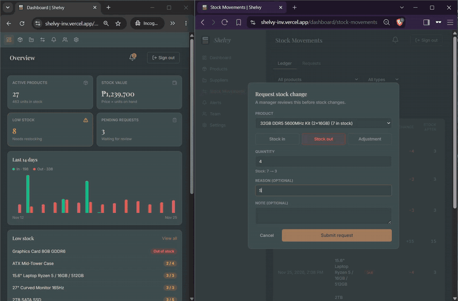

> The demo is a shared sample workspace ("ByteHub Computer Shop"). It resets automatically once a day, and actions like invites, billing and password changes are disabled. The API is on a free tier, so the first request after a quiet period can take a few seconds to wake up.

---

## Features

- **Multi-tenant organizations** with three roles: Owner, Manager and Staff.
- **Products and suppliers** with SKUs, prices, low-stock thresholds, search, filters and archiving.
- **Stock ledger.** Every change is a movement (opening, in, out, adjustment) with the resulting balance, who did it and why.
- **Stock requests.** Staff submit a request; managers and owners approve or reject it with a note. Approval applies the change atomically, so two managers approving at once can't double-apply it.
- **Real-time notifications** over socket.io (new request, decision, low stock), plus optional email (off, only if unread, or right away).
- **CSV import and export.** Import shows a preview of what will be created or updated before anything is saved.
- **Dashboard** with stock value, low-stock list, pending requests and a 14-day in/out chart.
- **Team management.** Owners invite members by email and assign roles.
- **Subscriptions** with Stripe Checkout (test mode): free and paid plans, billing history, cancel and resume.
- **Production basics:** rate limiting, Helmet, validation on every endpoint, error reporting with Sentry, cookie-based sessions.

## Screenshots

**Dashboard.** Stock value, low-stock list, pending requests and the last 14 days of movement.

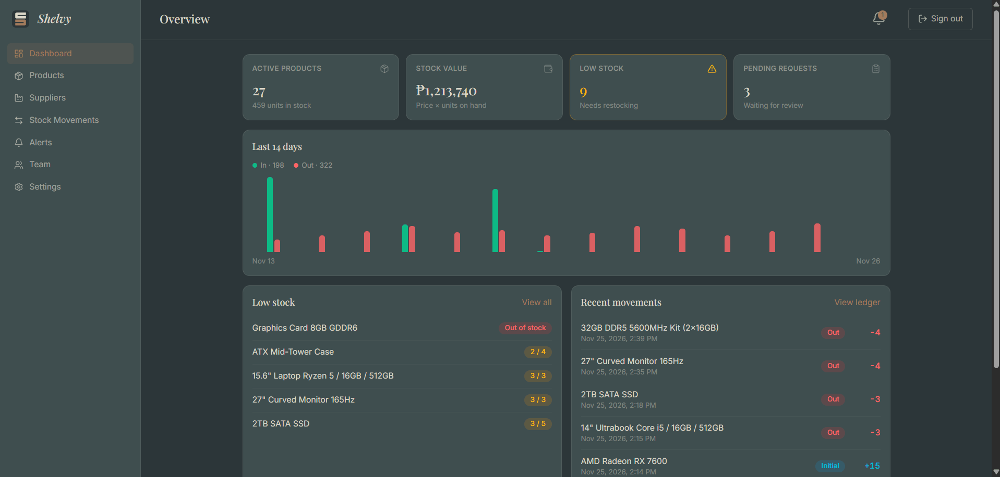

**Stock requests.** Staff ask, managers approve or reject.

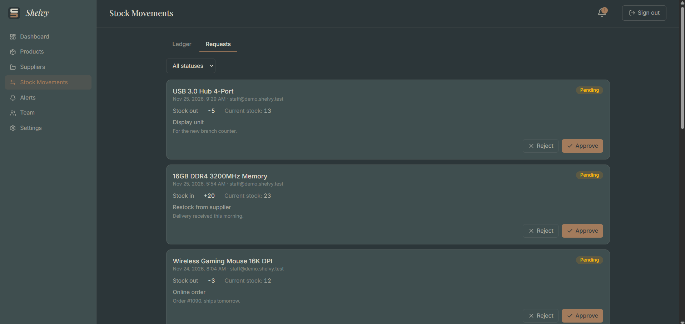

<table>
  <tr>
    <td width="50%">
      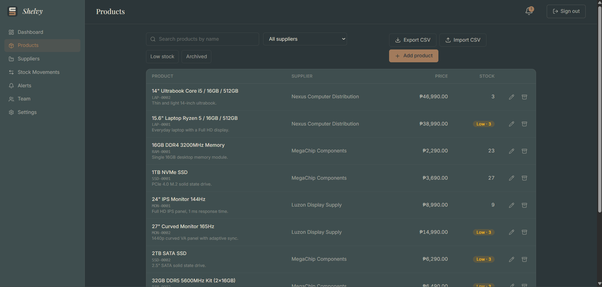
      <br><sub><b>Products.</b> Search, filter by supplier, archive.</sub>
    </td>
    <td width="50%">
      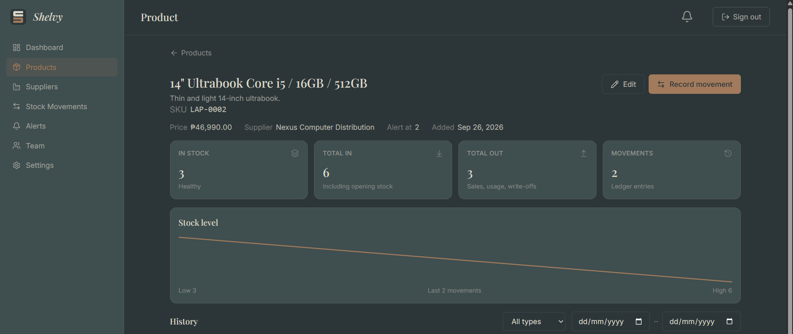
      <br><sub><b>Product detail.</b> Stock level over time and its history.</sub>
    </td>
  </tr>
  <tr>
    <td width="50%">
      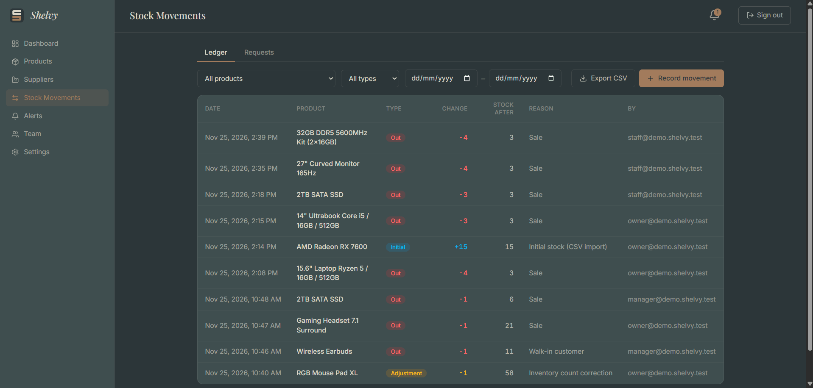
      <br><sub><b>Ledger.</b> Every change, with who did it and why.</sub>
    </td>
    <td width="50%">
      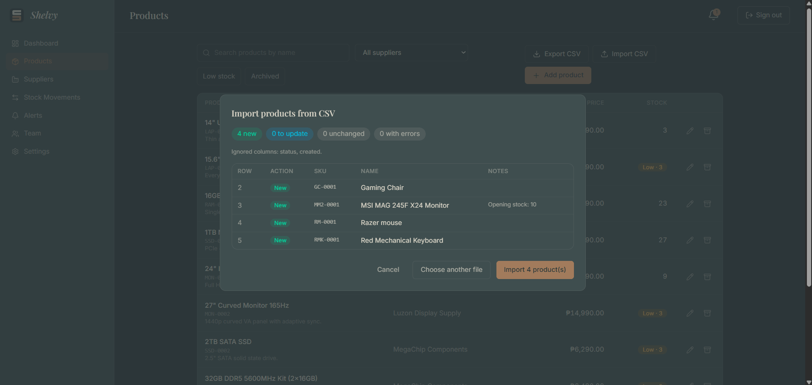
      <br><sub><b>CSV import.</b> Preview what will change before saving.</sub>
    </td>
  </tr>
  <tr>
    <td width="50%">
      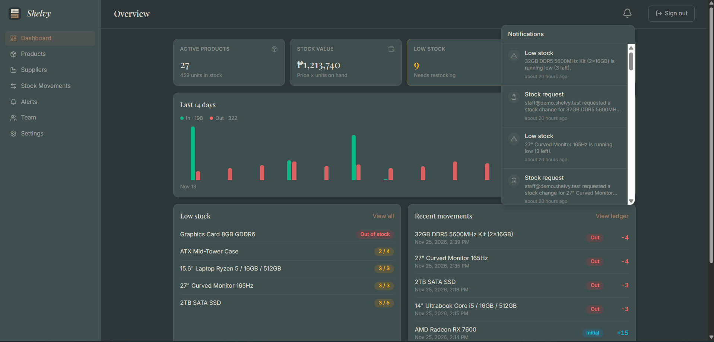
      <br><sub><b>Notifications.</b> New requests and low-stock alerts.</sub>
    </td>
    <td width="50%">
      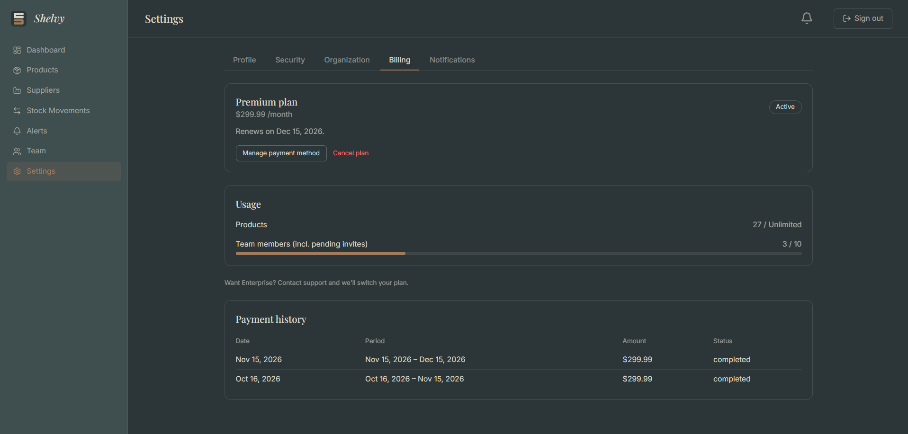
      <br><sub><b>Billing.</b> Plan, usage and payment history (Stripe test mode).</sub>
    </td>
  </tr>
</table>

**Works on mobile too.**

<p>
  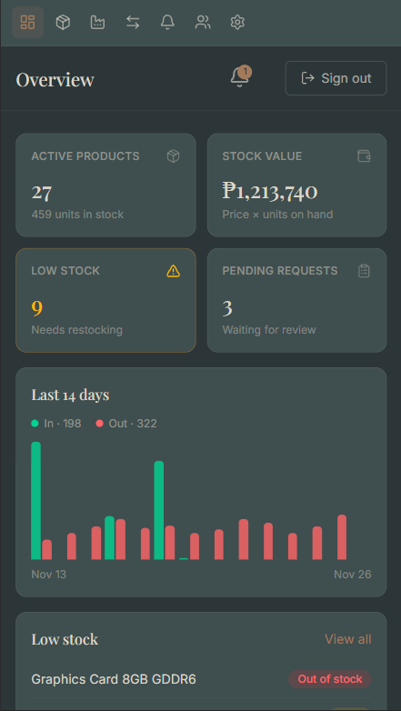
  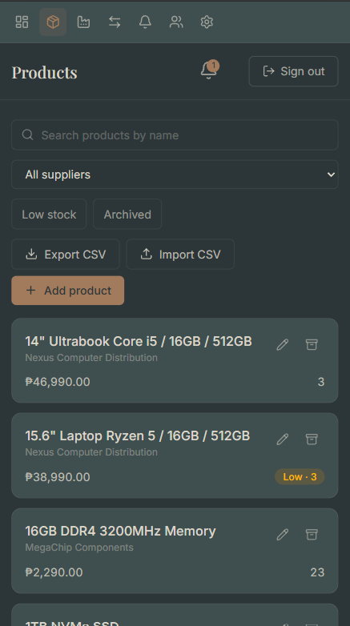
  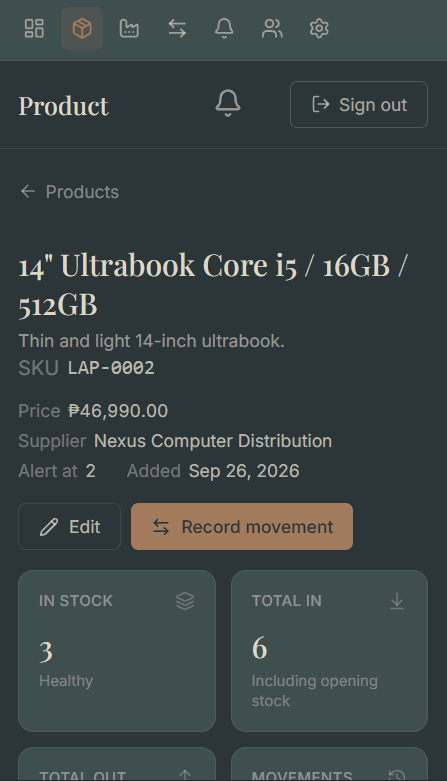
</p>

## Roles

| | Owner | Manager | Staff |
|---|:--:|:--:|:--:|
| View products, suppliers and the ledger | ✓ | ✓ | ✓ |
| Record stock movements directly | ✓ | ✓ | |
| Submit a stock request | | | ✓ |
| Approve or reject requests | ✓ | ✓ | |
| Manage team and invites | ✓ | | |
| Organization settings and billing | ✓ | | |

<!-- TODO: confirm this table matches your permission guard -->

## Tech stack

| Layer | Tools |
|---|---|
| Web | Next.js 16 (App Router), React 19, Tailwind CSS 4, motion, sonner |
| API | NestJS 11, class-validator, Swagger, throttler, socket.io |
| Database | PostgreSQL on Neon, Prisma 7 |
| Payments | Stripe (test mode) |
| Email | Nodemailer (Brevo in production, Mailtrap in development) |
| Monitoring | Sentry (API and web) |
| Hosting | Vercel (web), Render (API), Neon (database) |
| Tooling | npm workspaces, Turborepo, Docker |

## Architecture

```
Browser ──► Next.js on Vercel ──► NestJS API on Render ──► Postgres on Neon
   ▲                                  │  ├─► Stripe (checkout + webhooks)
   └──────── socket.io (live events) ─┘  ├─► Brevo / Mailtrap (email)
                                         └─► Sentry
```

- The `token` session cookie is set by the web app's server actions, which call the API.
- Stock is only ever changed through a stock movement. Each movement is written in a transaction that updates the product's balance and records `stockAfter`, so the ledger always adds up.
- Approving a request locks the request first and then the product, so concurrent approvals can't deadlock or double-apply.

```
apps/
  api/    NestJS API, Prisma schema and migrations
  web/    Next.js app
packages/ shared lint and TypeScript config
```

## Run it locally

**Requirements:** Node 18+, npm 11, a [Neon](https://neon.tech) Postgres database (the API uses the Neon serverless driver, so a plain local Postgres won't connect), and optionally Docker.

```bash
git clone <this repo>
cd Shelvy
npm install

# 1. Environment
cp apps/api/.env.example apps/api/.env      # then fill in the values
cp apps/web/.env.example apps/web/.env

# 2. Database
cd apps/api
npx prisma migrate deploy
cd ../..

# 3. Start the API (port 3001) and the web app (port 3000) together
npm run dev
```

Open http://localhost:3000. API docs are at `/api/docs` on the API.

With Docker instead: `npm run docker:dev` (add `:build` after a dependency change).

**Seed the demo workspace** (optional, creates the Owner/Manager/Staff demo accounts with 60 days of history):

```bash
cd apps/api
npm run build
npm run seed:demo        # needs DEMO_PASSWORD in apps/api/.env
```

### Environment variables

Names only, set your own values. <!-- TODO: replace with the real list from your .env.example -->

| Where | Variable | Purpose |
|---|---|---|
| API | `DATABASE_URL` | Neon connection string |
| API | `JWT_SECRET` | Signs session tokens |
| API | `STRIPE_SECRET_KEY`, `STRIPE_WEBHOOK_SECRET` | Stripe |
| API | `DEMO_PASSWORD` | Password for the demo accounts (server side only) |
| API | `SENTRY_DSN` | Error reporting (optional) |
| API | `INTERNAL_API_KEY` | Lets the web server pass the real client IP for rate limiting |
| API | mail settings | SMTP credentials for invites and notifications |
| Web | `NEXT_PUBLIC_API_URL` | Base URL of the API |
| Web | `NEXT_PUBLIC_SENTRY_DSN`, `SENTRY_AUTH_TOKEN` | Sentry (optional) |

## Useful scripts

| Command | What it does |
|---|---|
| `npm run dev` | API and web in watch mode |
| `npm run build` | Build everything with Turborepo |
| `npm run lint` / `npm run check-types` | Lint and type-check |
| `npm test` | Run the tests |
| `npm run docker:dev` | Everything in Docker |
| `npm run docker:prisma:migrate` | Run migrations inside the container |

## Backups

<!-- TODO: fill in after the Neon restore test -->

## Roadmap

- Concurrency test suite for stock movements
- CQRS for the heavier write paths
- Bot protection on sign-up
- Stripe live mode checklist

## License

<!-- TODO: add a license, or "All rights reserved" -->
